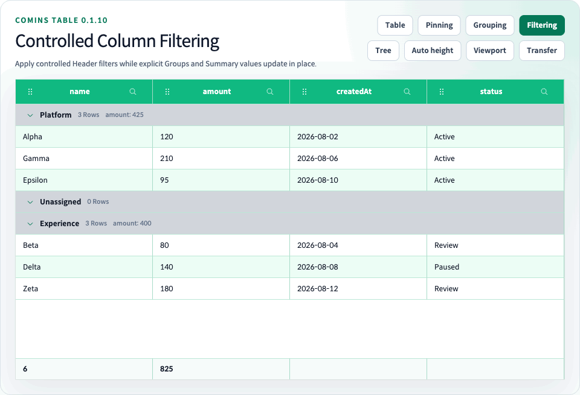

# Column Filtering

<!-- comins-restriction: filtering-no-remote-loading -->

[Documentation](../README.md) · [English guides](README.md) · [한국어](../ko/21-column-filtering.md) · [Playground](http://127.0.0.1:4002/examples/column-filtering)



Comins Table provides controlled client-side Column Filtering for flat application-owned `data`. Each Column opts into a value kind through `columns[].filter`, while the application owns both the complete `columnFiltering.model` and the currently open Header Filter popover.

Run the [`/examples/column-filtering`](http://127.0.0.1:4002/examples/column-filtering) Playground route for text, number, UTC date, boolean, Summary Row, sorting, and Row Grouping integration.

## Controlled model

<!-- comins-doc-example: compile=column-filtering -->
```tsx
type Row = {
  active: boolean;
  amount: number;
  id: string;
  joinedAt: string;
  name: string;
};

const [model, setModel] = useState<CominsColumnFilterModel>([]);
const [openColumnId, setOpenColumnId] = useState<string | null>(null);

const columns: Array<CominsTableColumn<Row>> = [
  { field: "name", filter: { kind: "text" }, label: "Name", sort: true },
  { field: "amount", filter: { kind: "number" }, label: "Amount", sort: true },
  { field: "joinedAt", filter: { kind: "date" }, label: "Joined", sort: true },
  { field: "active", filter: { kind: "boolean" }, label: "Enabled", sort: true },
];

<CominsTable
  columnFiltering={{
    model,
    onChangeModel: setModel,
    onChangeOpenColumnId: setOpenColumnId,
    openColumnId,
  }}
  columns={columns}
  data={rows}
  getRowId={(row) => row.id}
/>
```

`CominsColumnFilteringConfig` never stores application state internally. `onChangeModel` receives the next complete array after editing or clearing one Column. `onChangeOpenColumnId` receives the next Column ID or `null`; writing it back to `openColumnId` opens one popover at a time.

If `onChangeOpenColumnId` is omitted, Header Filter buttons are disabled. If an externally controlled popover is open without `onChangeModel`, its editor is read-only. Filter buttons and popovers isolate click, keyboard, pointer, sorting, resize, and Column Move interactions. Outside pointer input and `Escape` close through the controlled callback; `Escape` returns focus to the trigger.

## Column configuration and operators

`CominsColumnFilterConfig<TData, TValue>` uses `CominsColumnFilterKind`; each rule uses a `CominsColumnFilterOperator`. They support these values:

| Kind | Operators |
| --- | --- |
| `text` | `contains`, `notContains`, `startsWith`, `endsWith`, `equals`, `notEquals`, `isEmpty`, `isNotEmpty` |
| `number` | `equals`, `notEquals`, `greaterThan`, `greaterThanOrEqual`, `lessThan`, `lessThanOrEqual`, `between`, `isEmpty`, `isNotEmpty` |
| `date` | The same comparison, range, and empty operators as `number` |
| `boolean` | `equals`, `notEquals`, `isEmpty`, `isNotEmpty` |

Text matching is case-insensitive by default. Set `caseSensitive: true` on the Column Filter configuration for exact casing. Whitespace is a text value; only `null`, `undefined`, and `""` are empty.

Number comparison accepts finite numeric Row values and finite numeric model values. `between` normalizes reversed endpoints into an inclusive range. Non-numeric Row values and `NaN` do not match numeric rules.

Date filtering uses UTC calendar days. Model values should be exact `YYYY-MM-DD` strings, and Row values may be valid dates, timestamps, or date strings that normalize to a UTC day. Invalid calendar dates are ignored rather than coerced.

Use `filter.getValue` when the comparison value differs from the normal nested `field` value:

<!-- comins-doc-example: fragment -->
```tsx
{
  field: "owner",
  label: "Owner",
  filter: {
    kind: "text",
    getValue: ({ row }) => row.owner?.displayName,
  },
}
```

## Normalization

`CominsColumnFilterRule` contains `columnId`, `operator`, optional `value`, and optional `valueTo`. Rules across different Columns use AND. When duplicate valid rules address one Column, the first valid rule wins.

Unknown Columns, Columns without `filter`, unsupported operator/kind pairs, invalid values, and malformed untyped entries are ignored. If no valid rule remains, all source Rows are visible. The original `data` array and business Row identities are never mutated.

## Projection, sorting, and Summary

The client-side projection order is:

1. Filter source Row indexes.
2. Build Row Group membership when configured.
3. Apply the existing Row sorting policy.
4. Apply flat pagination or virtualization.
5. Render leaf Rows and Details using their fixed or automatic height policies.

Summary Row aggregation uses filtered leaf Rows before flat pagination. Header sorting does not modify or reorder the Filter model. An out-of-range flat `pageIndex` is clamped to the final page produced by the filtered Row count.

Selected Row IDs and expanded Row Detail IDs that are filtered out stay dormant and can reappear when the Filter changes. Hidden Cell or range selection is cleared because those addresses require a visible projection.

## Row Grouping integration

`columnFiltering` can be combined with controlled single-depth `rowGrouping`. Filtering changes only Group membership input:

- Every explicit Group remains visible, including Groups with zero filtered members.
- The application-owned `groups` array remains the Group position and order source of truth.
- Group counts and built-in aggregates use filtered members.
- Existing Header sorting still runs independently inside each Group and never reorders Group Rows.
- Controlled Group expansion IDs stay intact.
- Group Drag may remain enabled because it changes the explicit Group model, not the filtered Row projection.

## Boundaries

Column Filtering is a CSR flat-data feature. It cannot be combined with Tree Grid, Viewport Datasource, Infinite Scroll, Lazy Load, `loadingMore`, or Row Drag. Passing a `columnFiltering` configuration disables Row Drag even when the model is empty, because movement through a potentially partial projection is ambiguous. Grouped Filtering also inherits the Row Grouping prohibition on pagination.

Server-side filtering, custom Filter editor renderers, OR groups, multi-rule-per-Column evaluation, locale-aware text collation, fuzzy search, relative dates, Tree filtering, and remote datasource filtering are outside this release. Applications can still implement these policies by producing their own controlled `data` before passing it to Comins Table.

## Value lists and custom UI — introduced in 0.2.2

The 0.2.2 candidate adds `filter.mode: "values"`; the default remains `"condition"`. Keep `kind` for text/number/boolean/UTC date comparisons. Checked values use OR within one column and AND across columns. Every check immediately proposes the complete application-owned model through `onChangeModel`; update local state immediately and persist remotely separately. Without this callback, selection and Clear are readonly, while search remains available.

<!-- comins-doc-example: fragment -->
```tsx
const model: CominsColumnFilterModel = [
  { columnId: "status", operator: "in", values: ["Ready", "Blocked"] },
];
const columns: CominsTableColumn<{ status: string }>[] = [{
  field: "status", label: "Status", filter: {
    kind: "text", mode: "values",
    option: { props: { className: "status-option" }, render: ({ option }) => <strong>{option.label}</strong> },
    panel: { render: p => <section>
      <input {...p.getSearchInputProps()} />
      <label><input {...p.getSelectAllProps()} />Select matching values</label>
      <ul>{p.visibleOptions.map(option => <li key={option.id} {...p.getOptionContainerProps(option)}>
        <input {...p.getOptionProps(option)} />{p.renderOption(option)}<small>{option.count}</small>
      </li>)}</ul>
      <button {...p.getClearProps()}>Clear</button><button {...p.getCloseProps()}>Close</button>
    </section> },
  },
}];
```

No rule means unrestricted, including future values. `in.values: []` means no matches and stays active. Explicitly checking every current value preserves a snapshot; only Clear or selecting all with an empty search removes the rule. Searching narrows the option list, not table data. Select/deselect all during search affects only matching options and preserves other selections. Close/Escape keeps applied choices; reopening resets search.

Options come from all supplied leaf rows, before pagination, grouping or virtualization. Counts apply other columns' conditions while ignoring this column's rule. Zero-count options stay visible and selectable. A selected value missing from new data remains with `present: false` and count 0; data changes never silently rewrite the model. Model values are JSON primitives (`CominsColumnFilterValue`); objects require a scalar `getValue`. Null, undefined and empty source strings share a null option, while 0, false and whitespace remain distinct. Numbers must be finite actual numbers. Text uses the existing caseSensitive policy; dates compare UTC calendar days. An invalid member invalidates the whole in rule; a valid empty array does not. First valid rule per column still wins.

`filter.getOptionLabel(value)` returns a plain string used for display, case-insensitive substring search and accessible names. It does not change identity or comparison. Do not derive search text from JSX. `CominsColumnFilterOption.id` is an opaque stable key, not an array index or DOM ID. `selectionMode` distinguishes all/unrestricted from include/explicit; counts of selected options are not row counts. Missing selections count as options too.

| Setting | Replacement and bindings |
| --- | --- |
| `trigger.render` | The actual opener. Spread `getTriggerProps()` on a button; `{ element: "custom" }` supports a focusable HTMLElement with button role/Enter/Space. |
| `option.render` | Badge/icon/label content; the built-in checkbox remains owned. |
| `panel.render` | Search, selection controls and inner tags such as section/ul/li. Use getters on the real elements; owned dialog positioning/outside close remains. |
| `trigger.props`, `option.props`, `panel.props` | className/style or a payload callback. Option wrapper styling uses getOptionContainerProps, selection uses getOptionProps. |

`CominsValueFilterTriggerRenderParams`, `CominsValueFilterOptionRenderParams`, `CominsValueFilterPanelRenderParams` and `CominsValueFilterActions` describe the React contracts. The panel provides query/options/visibleOptions, selection summaries, setQuery/setOptionSelected/setVisibleSelected/clear/close and renderOption. Custom panels explicitly call renderOption; option.render is not inserted again automatically. Trigger selection summaries are available while the values panel is open; closed triggers do not eagerly collect all options. Restored condition rules retain the condition editor, skip values panel/option render and have no values summary until cleared.

Use native checkbox getters by default. For custom tags, `getOptionProps(option, { element: "custom" })` supplies checkbox role, aria-checked and Space/click handling. getSelectAllProps also supports native indeterminate/custom mixed. Getters compose user handlers and refs; preventDefault cancels internal behavior. Required controlled values/roles/ARIA are protected. Do not attach an additional toggle to the label or wrapper. Helpers must reach actual DOM elements; an unbound custom component cannot inherit focus/keyboard guarantees. Hooks belong inside returned components, not render callbacks.

Undefined render returns select built-in content; null/false/empty strings clear only that region, and errors propagate. Empty trigger content requires externally controlled opening. Empty panel content preserves the dialog boundary. Escape/Close restores a live trigger; outside pointer or Tab departure closes without stealing external focus. The dialog is non-modal and does not trap Tab. Refs/listeners are cleaned on removal; the table's ownerDocument is used. Styling retains `comins-column-filter` classes and table theme tokens, plus data-active/data-selected/data-readonly/data-present. Custom panel.props style an inner wrapper, not the fixed-position dialog.

For framework-neutral consumers, `getCominsColumnFilterOptions`, `setCominsColumnFilterValues`, `normalizeCominsColumnFilterModel` and `getCominsFilteredRowIndexes` are exported from `comins-table/core`. Their inputs use neutral columns and source rows; root functions accept React columns. `CominsColumnFilterOptionsInput`, `CominsColumnFilterOptionsResult` and `CominsColumnFilterValuesAction` describe pure calculations and immutable proposals. Options return null for an unsupported target or an active condition rule; value selection actions preserve such models, while Clear removes the target rule. No React/DOM/render configuration enters Core.

These APIs are not available in published 0.2.1. Existing filtering restrictions still apply: no Tree/Viewport/Infinite/Lazy/server filtering or ordinary row drag. Option-list virtualization is not provided; large numbers of distinct values can be expensive. The Playground includes 10,000-row measurement fixtures without truncating values or promising unlimited performance.
